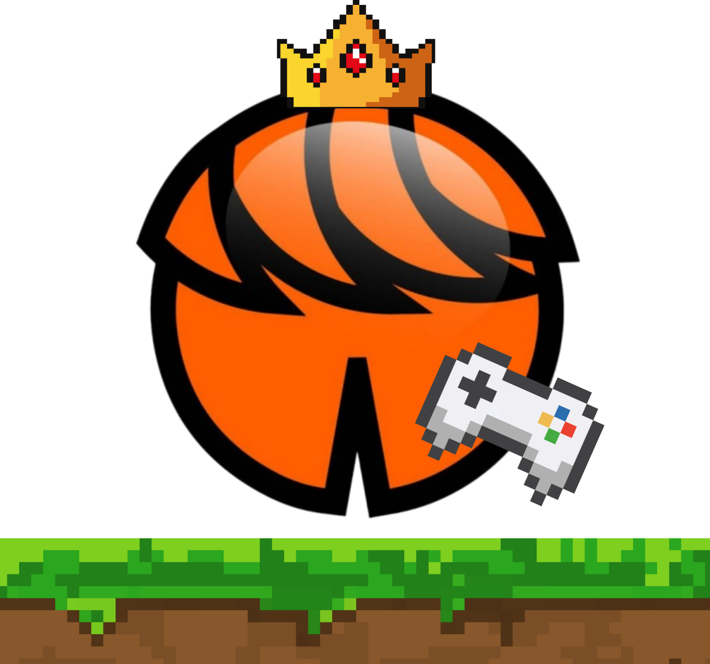
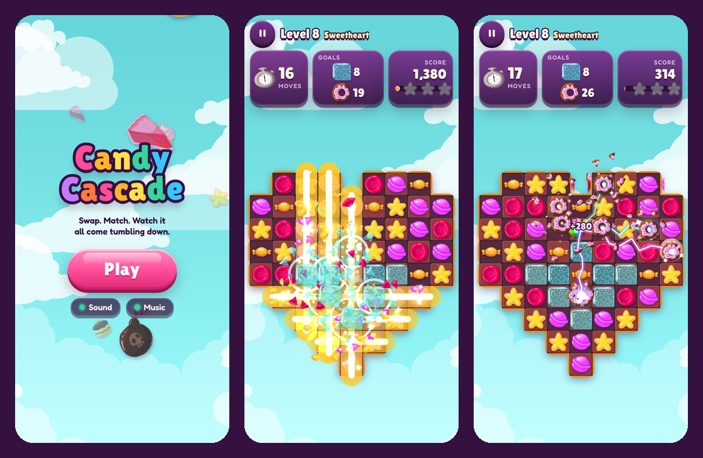
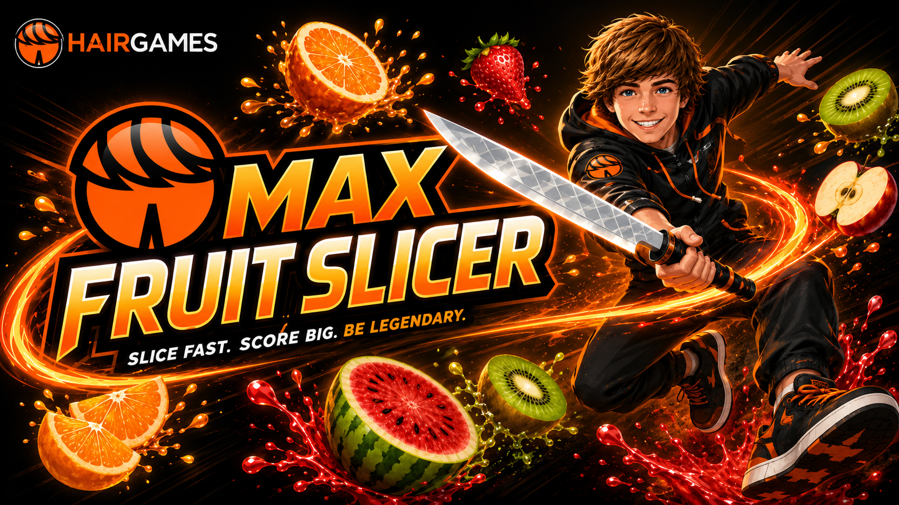
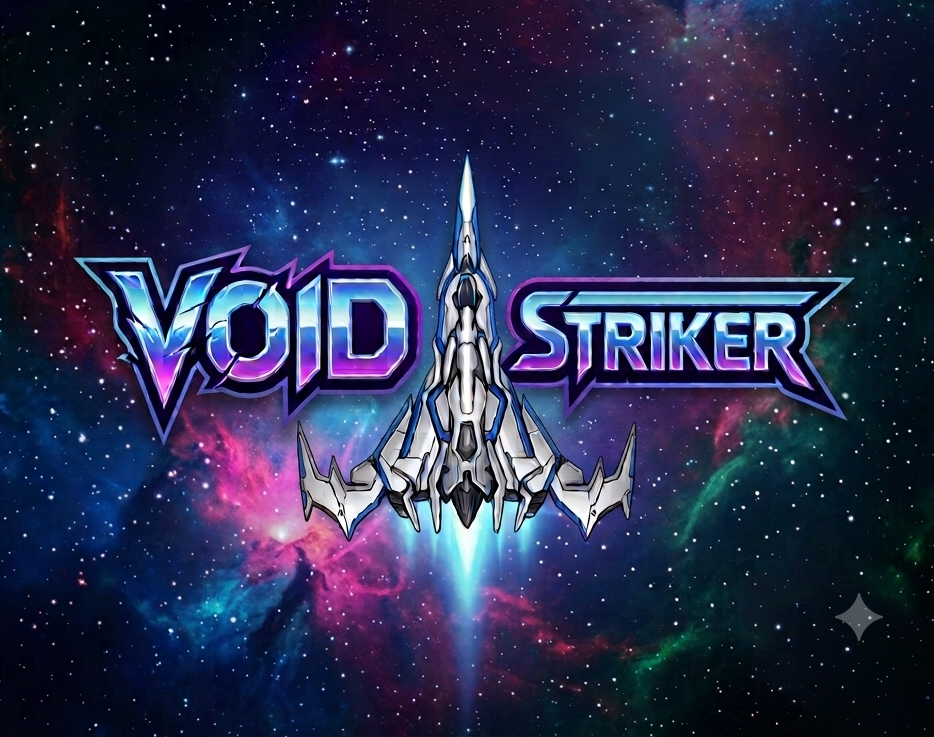
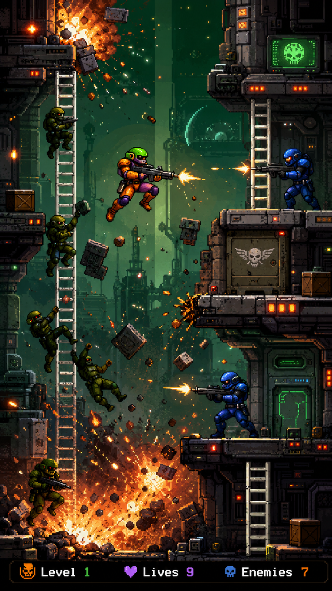
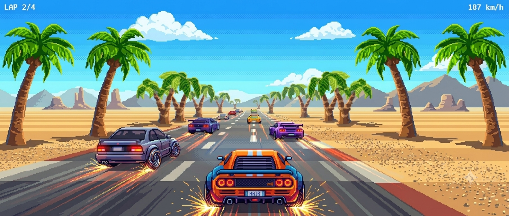
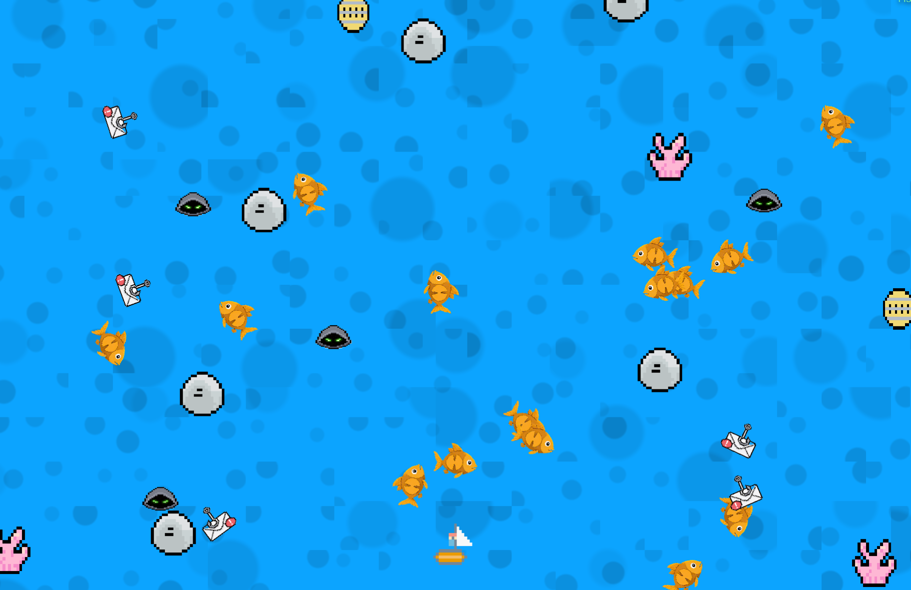
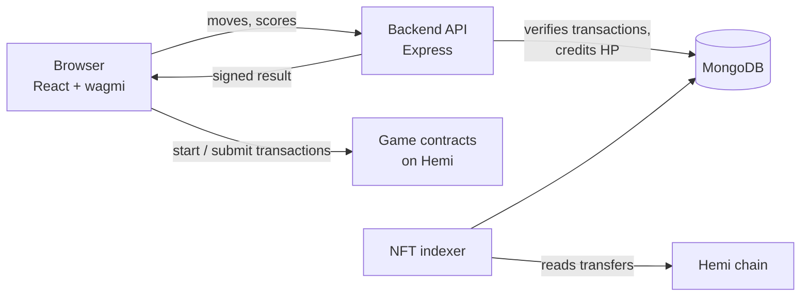

<p align="center">
  
</p>

<h1 align="center">HairGames</h1>

<p align="center">
  An arcade of on-chain games on the <a href="https://hemi.xyz">Hemi</a> network.<br>
  Play in your browser, put your score on chain, and earn Hair Points.
</p>

<p align="center">
  <a href="https://game.hairtoken.xyz"><b>Play now</b></a> ·
  <a href="https://x.com/HairMaxToken">X</a> ·
  <a href="https://discord.gg/uNt4FyWvqP">Discord</a> ·
  <a href="https://explorer.hemi.xyz/token/0x5B774f563C902FA7b203FB7029ed6eD4Ce274705">$HAIR</a>
</p>

---

## The games

| | Game | |
| --- | --- | --- |
|  | **Candy Cascade**<br>500 levels of match-3 across 25 episodes, with your progress, stars and best scores saved on chain. Difficulty climbs every 5 levels. | Puzzle |
|  | **Proof of Patience**<br>A meme shooter about the Hemi team's long-awaited answers to the community's questions. Hold the line before the backlog takes over the show. | Shooter |
|  | **Max Fruit Slicer 200**<br>Slice fruit, chain combos and stay clear of the bombs. | Slicer |
|  | **Void Striker**<br>Classic 8-bit block mechanics meet high-speed cyber logic. | Shooter |
|  | **Space Huggers**<br>Fight through the levels and complete the mission. | Adventure |
|  | **Need for Hair**<br>Three, two, one, go. Race to the finish, but slow down or you'll lose your HP. | Racing |
|  | **Max Prø Fishing 2026**<br>Catch fish across five levels and sell your haul. | Fishing |

Partner games from the Hemi ecosystem, like the open-world MMORPG **Bro Town**, are listed on the dashboard too.

## How it works

1. **Connect your wallet** on the Hemi network.
2. **Play a game.** Runs are recorded through each game's smart contract, with a small entry or save fee.
3. **Earn Hair Points (HP).** Your score turns into HP once its transaction is confirmed. Holding NFTs from ecosystem collections raises your multiplier, up to 1.5×.
4. **Climb.** Compete on the global leaderboard and the weekly event, rank up from Rookie to Immortal on your profile, finish bonus tasks, and vote for your favourite game every day.

## Fair play

Points are only worth something if they can't be faked, so every score is checked before it counts:

- **Signed results.** A game contract only accepts a score signed by the HairGames server. Each signature is tied to one wallet, one contract and one chain, and can only be used once.
- **Replayed moves.** In Candy Cascade, the server picks each board's random seed and then replays the player's exact moves with the game's own engine. Only the score from that replay is signed; whatever the game client reports is ignored.
- **One win per start.** Every Candy Cascade attempt opens a numbered run on chain, and a win can only be saved against its own run.
- **No farming.** A Candy Cascade level with all 3 stars is finished. HP is paid for beating your previous best, not for repeating a level.
- **Points go to the player who played.** HP is credited from the contract's own events, and only to the wallet that sent the transaction.
- **No passing NFTs around.** NFT ownership comes from an on-chain indexer, and a newly received NFT counts toward the multiplier only after it has been held for 24 hours.

## Built with

| Layer | Stack |
| --- | --- |
| Frontend | React 19, Vite, Tailwind CSS 4, Framer Motion, wagmi, viem, RainbowKit |
| Backend | Node.js, Express, MongoDB (Mongoose), ethers v6 |
| Contracts | Solidity 0.8.24, OpenZeppelin 5, Hardhat |
| Chain | Hemi mainnet (chain ID 43111) |



## Smart contracts

All game contracts are deployed on Hemi mainnet:

| Game | Contract |
| --- | --- |
| Proof of Patience | [`0x760d…728C`](https://explorer.hemi.xyz/address/0x760d91401Afb3499cf1BD0256b30485BDa40728C) |
| Max Fruit Slicer 200 | [`0x1f2a…8CFd`](https://explorer.hemi.xyz/address/0x1f2a78Ce71aFbac323bEDc3404d206E7F94D8CFd) |
| Void Striker | [`0x61A8…a8E5`](https://explorer.hemi.xyz/address/0x61A86E5B2075d0E6ff659a6b29D1E367CAa6a8E5) |
| Space Huggers | [`0x8950…9750`](https://explorer.hemi.xyz/address/0x895087a3b85C38DAB365495A5E1EA518459A9750) |
| Need for Hair | [`0x3E07…6E29`](https://explorer.hemi.xyz/address/0x3E0784ffE4e036bCc1859CA124dF327e8B866E29) |
| Max Prø Fishing 2026 | [`0x45ce…a7eA`](https://explorer.hemi.xyz/address/0x45cee112Ba2EbDE8224a1fA14D329f6AB190a7eA) |

Contract sources are in [`contract/contracts`](contract/contracts), including the new [`CandyCascade.sol`](contract/contracts/CandyCascade.sol).

## Run it locally

You'll need Node.js 20 or later, a MongoDB instance on `mongodb://127.0.0.1:27017`, and a browser wallet.

```bash
git clone https://github.com/HAIR-Max/HairGames.git
cd HairGames
npm install
```

Create `client/.env`:

```bash
VITE_API_URL=http://localhost:3000
```

Create `.env` in the repository root for the backend:

```bash
SERVER_PRIVATE_KEY=0x...   # signs verified game results; use a throwaway key locally
```

Then start both parts:

```bash
npm run dev:client          # frontend on http://127.0.0.1:5000
node backend/server.js      # API on http://localhost:3000
```

The API only accepts browser requests from the origins listed in the CORS settings in `backend/server.js`. Add `http://127.0.0.1:5000` there while developing locally.

Contract and indexer tests run on a local chain:

```bash
cd contract
npm install
npm test
```

The full list of environment variables is in the [development guide](docs/development.md#environment-variables).

## Project structure

```
client/      React frontend: site pages and one folder per game
backend/     Express API: score verification, HP, profiles, NFT indexer
contract/    Solidity contracts, deploy scripts and tests
docs/        Development guide
```

Candy Cascade's game code lives in its own repository, [candy-Cascade](https://github.com/Nabilislam722/candy-Cascade).

## Contributing

Contributions are welcome. The [development guide](docs/development.md) covers how the code is organised, the conventions each game folder follows, and how the anti-cheat and NFT indexer work. Please open an issue to discuss larger changes before starting.

If you find a security issue, please report it privately to the team on [Discord](https://discord.gg/uNt4FyWvqP) instead of opening a public issue.

## License

MIT


