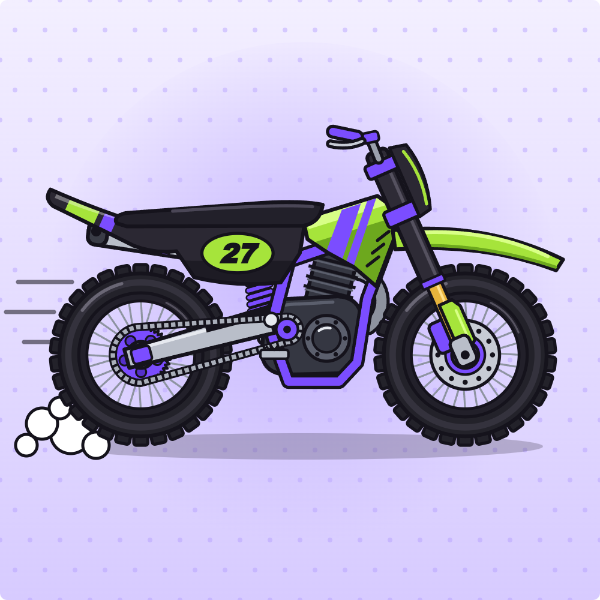

# Venom NFT

The #27 Venom is the OP bike of Moto Rush. It's the fifth bike in the garage, the fastest and strongest in the game, and the only one with stats above the 5-point garage scale. The NFT is an edition of one artwork: every token is the same bike, numbered `Venom #1` to `Venom #50`.



## Holder perks

- **+0.2x Hair Points multiplier in Moto Rush.** It's added on top of the holder's regular NFT multiplier, and it can go past the regular 1.5x cap. It counts once per wallet, however many Venoms the wallet holds, and only after the usual 24-hour hold period.

  | Regular multiplier | In Moto Rush with a Venom |
  | --- | --- |
  | 1.0x (no other NFTs) | 1.2x |
  | 1.25x | 1.45x |
  | 1.5x (max) | 1.7x |

  The Venom doesn't raise the multiplier in any other game.
- **The bike itself:** holders ride the #27 Venom in Moto Rush as soon as the NFT is in their wallet. The Moto Rush page checks the connected wallet; everyone else sees it locked as "NFT holders only".

## Stats

All numbers are from the game code: `BIKES` in `client/public/moto-rush/js/sim.js` and `ENGINES.op` in `js/audio.js`. `generate-metadata.mjs` refuses to run if `launch.config.json` stops matching them.

**Garage ratings** (shown as bars in the garage, scale of 5):

| Bike | Unlock | Speed | Power | Handling |
| --- | --- | --- | --- | --- |
| Storm RR | Starter | 3 | 3 | 3 |
| Tricolore | 5 stars | 4 | 4 | 3 |
| Rosso V4 | 12 stars | 5 | 4 | 4 |
| Viper Z | 20 stars | 5 | 5 | 5 |
| **#27 Venom** | **NFT** | **6** | **6** | **6** |

**Physics:**

| Bike | Motor speed | Torque | Lean | Flip spin |
| --- | --- | --- | --- | --- |
| Storm RR | 54 | 17 | 1.00 | 5.2 |
| Tricolore | 58 | 19 | 1.08 | 5.6 |
| Rosso V4 | 62 | 21 | 1.18 | 6.0 |
| Viper Z | 66 | 23 | 1.25 | 6.4 |
| **#27 Venom** | **75** (+14% on Viper Z) | **27** (+17%) | **1.45** (+16%) | **7.2** (+13%) |

- **Motor speed:** the rear wheel's drive speed, which sets top speed.
- **Torque:** drive force, for acceleration and climbing. Braking uses 1.4x of it.
- **Lean:** how hard the rider can rotate the bike forward and back.
- **Flip spin:** the fastest rotation in the air (75% of it on the ground). Each landed flip takes 1 second off the time.

**Engine:** turbo two-stroke with 5 gears, a turbo whistle and a blow-off valve. Its sound is unique to the Venom.

**Measured on all 500 tracks:** each bike rode every track with the game's built-in autopilot.

| Bike | Tracks finished | Median time | Top speed |
| --- | --- | --- | --- |
| Storm RR | 500 | 48.7 s | 109 km/h |
| Tricolore | 492 | 45.8 s | 112 km/h |
| Rosso V4 | 495 | 43.6 s | 114 km/h |
| Viper Z | 500 | 42.4 s | 116 km/h |
| **#27 Venom** | **464** | **39.6 s** | **124 km/h** |

On tracks both bikes finish, the Venom is faster than every other bike:

| Compared with | Venom faster by (median) | Venom faster on |
| --- | --- | --- |
| Storm RR | 17.4% | every track |
| Tricolore | 12.1% | every track |
| Rosso V4 | 8.1% | every track |
| Viper Z | 4.5% | 95% of tracks |

The autopilot crashes the Venom on 36 tracks because its extra power and lean make it twitchier. The autopilot was tuned on the stock bikes; a human rider adjusts. Even so, "fastest but takes skill" is the honest way to sell it.

## Files

| Path | What it is |
| --- | --- |
| `art/venom.png` | The artwork, 1000×1000 PNG (278 KB). This one file is all you upload to IPFS. |
| `launch.config.json` | Everything you edit: name, symbol, supply, description, image link, royalties, Mintora address, HairGames settings, bike stats. |
| `generate-metadata.mjs` | Builds the metadata from the config and checks the stats against the game. `npm run venom:preview` writes `preview/`. |
| `preview/` | Token #1 and the collection exactly as wallets and marketplaces will show them. For checking only, nothing to upload. |
| `deployment.json` | Written by the deploy: contract address, deploy block, constructor arguments. The admin commands read it. |

The contract and its scripts are one level up, in the NFT Hardhat project (`nft/`). That project is separate from the game contracts in `contract/`:

| Path | What it is |
| --- | --- |
| `nft/contracts/Venom.sol` | The NFT, an ERC-721. |
| `nft/scripts/deploy-venom.js` | Deploys it from `launch.config.json`, verifies the source and saves `deployment.json`. |
| `nft/tasks/venom.js` | Admin commands: mint, list on Mintora, update metadata, freeze. |
| `nft/test/Venom.test.js` | Tests, run with `npm test` in `nft/`. Includes a full sale on a Mintora-style marketplace. |

## How it works

- **You mint all 50 for the gas alone and sell them on Mintora.** Only the contract owner can mint, and there's no public mint.
- **The metadata lives in the contract.** `tokenURI()` returns the token's JSON itself (name, description, image, stats) instead of a link to a file:
  - wallets, DeBank-style trackers and marketplaces never wait on a metadata server or a gateway
  - nothing about the metadata can be rate-limited or go missing
  - Mintora's sync reads it directly
- **Only the image lives on IPFS,** as `ipfs://<CID>`. That's the standard every platform understands. Each fetches it through its own IPFS gateway and keeps a cached copy, and the CID guarantees nobody can swap the art.
- **Fixing mistakes:** the metadata (image link, description, stats) can be corrected until you freeze it for good. Marketplaces are told to refresh when it changes.
- **Royalties:** 5% (ERC-2981) to `royalty.recipient`, or to the deployer if that's empty. Mintora pays this automatically on every sale, alongside its own 5% fee.
- **Enumerable,** so the HairGames indexer can list a wallet's tokens when it repairs holdings.

## How to launch

The whole launch costs very little: measured at Hemi's current gas price, deploying, minting 50 and listing 50 is about 0.00002 ETH of gas. Even with Hemi's small data fee per transaction, it stays well under 0.005 ETH.

### 1. Get set up (once)

- **The NFT project:** run `npm install` in `nft/`.
- **A deployer wallet with a little ETH on Hemi.** Use a fresh wallet. It becomes the contract owner and holds all 50 Venoms until they sell, so it's the wallet you list from.
- **Its private key in `nft/.env`:**
  ```
  DEPLOYER_PRIVATE_KEY=0x...
  ```
  The file is there with the line empty. It's git-ignored and separate from `contract/.env`. To list on Mintora's website instead of with the commands below, import the same wallet into your browser wallet.

### 2. Put the image on IPFS

1. **Upload:** sign up at **pinata.cloud** (the free plan is plenty) and upload the file `nft/venom/art/venom.png`. Make sure it goes to **public** IPFS, not private files.
2. **Copy its CID**, the ID starting with `bafy…` or `Qm…`, into `launch.config.json`:
   ```json
   "image": "ipfs://bafy...your-cid",
   ```
3. **Check it** by opening `https://ipfs.io/ipfs/<CID>` in a browser. It should show the bike. A fresh upload can take a minute.
4. **Optional backup:** pin the same CID with a second service, such as Filebase (free). Then the image stays up even if one of them drops it.

### 3. Preview and dry run

In `nft/`:

```
npm run venom:preview     # writes venom/preview/: token #1 and the collection as platforms will see them
npm run venom:dry-run     # deploys on a throwaway local chain, mints #1 and prints its on-chain metadata
```

### 4. Deploy

```
npm run deploy:venom
```

- **Before deploying,** it checks that the image is a real IPFS or https link, and stops with a message if anything isn't ready.
- **After deploying,** it:
  - saves `deployment.json`
  - verifies the source on explorer.hemi.xyz
  - prints the next steps below with your contract address filled in
- **It won't deploy a second contract by accident.** For that, set `VENOM_REDEPLOY=1`.

### 5. Mint all 50 to yourself

```
npx hardhat venom:mint --network hemi
```

This takes two transactions of 25. To send a few straight to someone, for giveaways, use `npx hardhat venom:mint <wallet> <amount> --network hemi`.

### 6. Connect it to HairGames

1. **Register the collection:** add the document the deploy printed to the `collectionconfigs` collection in MongoDB. Print it again with `npx hardhat venom:collection --network hemi`.
   - The NFT indexer then tracks holders, Venoms show on player profiles, and holders get the Moto Rush bonus.
   - `multiplier: 1` keeps the Venom out of the regular multiplier; the bonus comes only from `gameBonus`.
2. **Turn on holders-only riding:** in `client/.env`, add the line below, then rebuild and deploy the client.
   ```
   VITE_VENOM_CONTRACT=<contract address>
   ```
   From then on only holders ride the Venom; until then everyone rides it as a demo.

### 7. List them on Mintora

1. **Add the collection to Mintora** with `yarn list <contract address>` in the Mintora repo.
   - Do this after minting: Mintora syncs the tokens that exist at that moment.
   - Mintora's crawler has to be running to pick up the listings and sales that follow.
   - Upload a logo and banner for the collection in Mintora; it starts with placeholders. `art/venom.png` works for both.
2. **List every Venom you hold** at one price, from `nft/`:
   ```
   npx hardhat venom:list 0.01 --network hemi
   ```
   - It approves the marketplace once, then lists each token, one transaction each.
   - Run it again with a new price to reprice everything.
   - If it stops halfway, run it again: tokens already at that price are skipped.
   - `--from` and `--to` list just a range, for example to keep some back.
3. **Check:** `npx hardhat venom:status --network hemi` shows how many are listed and at what price. `npx hardhat venom:unlist --network hemi` takes them down.

### 8. Lock the metadata

Once everything looks right on Mintora and in wallets, run `npx hardhat venom:freeze --network hemi`. After that, nobody, you included, can change the image or stats. That's what buyers want to see. Until then, `npx hardhat venom:metadata --network hemi` pushes edits from `launch.config.json` to the contract.

### After a sale

- **The bike:** unlocks in Moto Rush right away, because the page reads the buyer's wallet.
- **The +0.2x Hair Points bonus:** counts after the 24-hour hold period, once Moto Rush pays Hair Points. Moto Rush must send `gameId: "moto_rush"` to `/api/points/add`; see `computeGameBonuses` in `backend/services/nftIndexer.js`.

### All the commands

Run in `nft/`, adding `--network hemi` to the `npx hardhat` ones:

| Command | What it does |
| --- | --- |
| `npm run venom:preview` | Shows the metadata platforms will see |
| `npm run venom:dry-run` | Practice deploy on a local chain |
| `npm run deploy:venom` | Deploys on Hemi |
| `npx hardhat venom:status` | Minted count, image, royalties, owner, Mintora listings |
| `npx hardhat venom:mint [wallet] [amount]` | Mints, by default everything left to you |
| `npx hardhat venom:list <eth>` | Lists or reprices your Venoms on Mintora |
| `npx hardhat venom:unlist` | Takes your Venoms off Mintora |
| `npx hardhat venom:metadata` | Pushes `launch.config.json` changes to the contract |
| `npx hardhat venom:freeze` | Locks the metadata for good |
| `npx hardhat venom:collection` | Prints the HairGames database entry |
| `npx hardhat venom:verify` | Retries source verification on the explorer |
